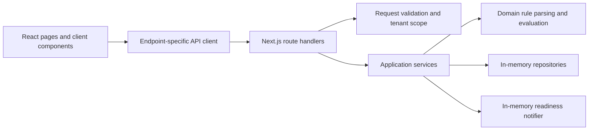
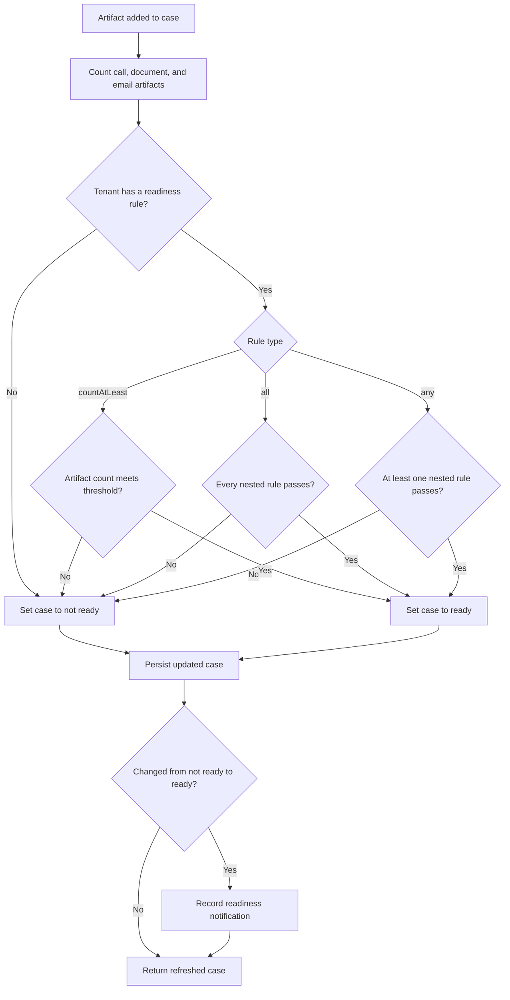

# Case Readiness Application

## Problem statement

The application determines whether a case is ready according to tenant-specific thresholds for call, document, and email artifacts. Cases and artifacts are tenant-scoped so one tenant cannot use another tenant's case data.

## Application overview

### Implemented

- Create and list tenants.
- Load and save a tenant's `countAtLeast` readiness rule.
- Create and list tenant-scoped cases.
- View a case's readiness status and artifact counts.
- Add call, document, or email artifacts and receive the refreshed case state.
- Recalculate readiness after an artifact is added and record an in-memory notification when a case transitions to ready.
- Validate requests and return structured API errors.

The application currently stores tenants, cases, artifacts, rules, and notifications in memory. Data is reset when the server process restarts.

### Planned functionality

Given more time, the next steps would be:

- **PostgreSQL persistence:** replace the in-memory repositories with durable, tenant-scoped storage and database migrations.
- **Database transactions:** make related writes, such as artifact creation and readiness updates, atomic and strongly consistent.
- **Transactional outbox and asynchronous webhooks:** record notification events in the same transaction as state changes, then deliver webhooks asynchronously with retry handling.
- **Tenant authentication and authorization:** authenticate callers and enforce tenant access at every application boundary.
- **Rule versioning:** retain rule history so readiness decisions can be associated with the rule version used.
- **Idempotency and concurrency handling:** prevent duplicate operations and protect updates from conflicting concurrent requests.
- **Logging, monitoring, and error handling:** add structured logs, operational metrics, tracing, alerting, and production-safe error reporting.

These items are not implemented in the current application. The REST API data-contract section below also remains a documentation placeholder.

## Technology stack

- Node.js 22.23.4
- Next.js 16 with the App Router
- React 19
- TypeScript 6
- Jest 30, React Testing Library, and jsdom
- ESLint 9 with the Next.js configuration

## Installation and development

Install the Node.js version from `.nvmrc`, install locked dependencies, and start the development server:

```bash
nvm use
npm ci
npm run dev
```

Open [http://localhost:3000](http://localhost:3000).

Create a production build and run it locally with:

```bash
npm run build
npm start
```

## Tests

Run the Jest suite once:

```bash
npm test
```

Run tests serially, as used by the project verification workflow:

```bash
npm test -- --runInBand
```

Run Jest in watch mode:

```bash
npm run test:watch
```

## System architecture



Route handlers manage HTTP concerns and delegate application behavior to services. Services enforce tenant boundaries and coordinate domain rules, repositories, and readiness notifications.

## Readiness decision logic



`all` and `any` evaluate their nested rules recursively. The current rule editor exposes `countAtLeast`. `src/domain/readiness-rule.ts` and its tests are the source of truth for rule parsing and evaluation, while `src/services/readiness-service.ts` owns artifact counting and readiness updates.

## REST API data contracts

> Documentation placeholder: add the existing endpoints' request, response, and error schemas here after reviewing the route handlers and route tests. This README intentionally does not define contracts beyond the implemented code.

## AI assistance disclosure

### 1. Overview

OpenAI Codex assisted with the Case Readiness application throughout scaffolding, configuration, testing, domain and service implementation, API integration, frontend development, and documentation. The work was completed incrementally from human-supplied requirements, constraints, corrections, and commit approvals.

### 2. Prompt usage outline

The following entries summarize representative prompts and their purpose; they are not verbatim transcripts.

| Prompt | Purpose | AI-assisted scope |
|---|---|---|
| Initial project scaffolding | Initialise a minimal Next.js App Router application using TypeScript, ESLint, basic CSS, and placeholder navigation | Project configuration, homepage, layout, styling, and placeholder pages |
| Jest configuration | Establish Jest, jsdom, and React Testing Library with a homepage smoke test | Test dependencies, configuration, scripts, setup, and initial test |
| Incremental backend implementation | Add tenant-scoped types, validation, repositories, readiness rules, services, notifications, and REST routes in reviewed phases | Domain logic, in-memory data access, application services, route handlers, and focused tests |
| `getApplication` integration | Compose shared repositories and services once, then connect thin API handlers to that application instance | Application composition, dependency wiring, API integration, and route tests |
| Frontend API integration | Replace placeholder pages with tenant, rule, case, and artifact workflows using the existing APIs | React components, pages, endpoint-specific client functions, loading and error states, and component tests |
| README documentation | Document the implemented application, setup, test commands, architecture, and readiness flow without inventing contracts | README content and Mermaid diagrams |
| Test coverage and verification | Add focused automated coverage and run the project checks at each review gate | Jest tests, ESLint, standalone TypeScript checking, and production builds |

### 3. Scope of retained AI assistance

AI-assisted output is retained across the project configuration, application pages, domain rules, repositories, services, notifier, API routes, frontend components, automated tests, and this README. The human contributor directed the requirements, requested changes, and approved commits; commit approval does not imply that retained code was independently reimplemented.

### 4. Verification and disclosure

Generated output was reviewed incrementally and adapted when requested, including removing premature directory scaffolding. The final application acceptance check completed all 48 Jest tests, ESLint, standalone TypeScript checking, and the Next.js production build successfully. The repository contents, tests, and Git history remain the source of truth for the retained implementation.
