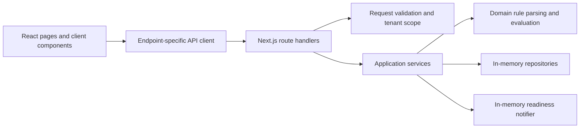
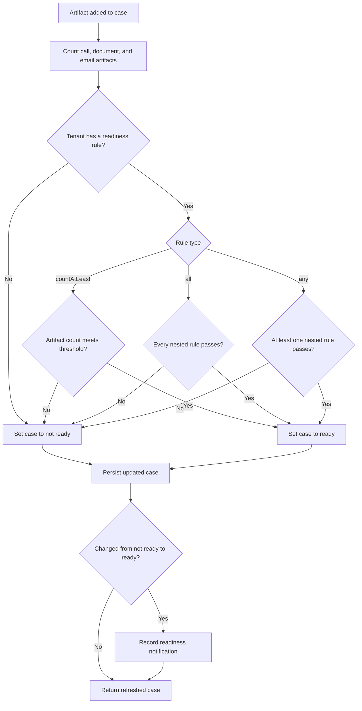

# Case Readiness Application

## Problem statement

The application determines whether a case is ready according to tenant-specific thresholds for call, document, and email artifacts. Cases and artifacts are tenant-scoped so one tenant cannot use another tenant's case data.

## Application overview

### Implemented

- Create and list tenants.
- Load and save a tenant's `countAtLeast` readiness rule.
- Create and list tenant-scoped cases.
- View a case's readiness status and artifact counts.
- Add call, document, or email artifacts and receive the refreshed case state.
- Recalculate readiness after an artifact is added and record an in-memory notification when a case transitions to ready.
- Validate requests and return structured API errors.

The application currently stores tenants, cases, artifacts, rules, and notifications in memory. Data is reset when the server process restarts.

### Planned functionality

No additional product functionality is specified in this repository. The readiness-logic and REST-contract sections below are documentation placeholders, not commitments to unimplemented features.

## Technology stack

- Node.js 22.23.4
- Next.js 16 with the App Router
- React 19
- TypeScript 6
- Jest 30, React Testing Library, and jsdom
- ESLint 9 with the Next.js configuration

## Installation and development

Install the Node.js version from `.nvmrc`, install locked dependencies, and start the development server:

```bash
nvm use
npm ci
npm run dev
```

Open [http://localhost:3000](http://localhost:3000).

Create a production build and run it locally with:

```bash
npm run build
npm start
```

## Tests

Run the Jest suite once:

```bash
npm test
```

Run tests serially, as used by the project verification workflow:

```bash
npm test -- --runInBand
```

Run Jest in watch mode:

```bash
npm run test:watch
```

## System architecture



Route handlers manage HTTP concerns and delegate application behavior to services. Services enforce tenant boundaries and coordinate domain rules, repositories, and readiness notifications.

## Readiness decision logic



`all` and `any` evaluate their nested rules recursively. The current rule editor exposes `countAtLeast`. `src/domain/readiness-rule.ts` and its tests are the source of truth for rule parsing and evaluation, while `src/services/readiness-service.ts` owns artifact counting and readiness updates.

## REST API data contracts

> Documentation placeholder: add the existing endpoints' request, response, and error schemas here after reviewing the route handlers and route tests. This README intentionally does not define contracts beyond the implemented code.

## AI assistance disclosure

OpenAI Codex was used to assist with implementation and with drafting this README. AI-assisted changes should be reviewed and verified before production use.
